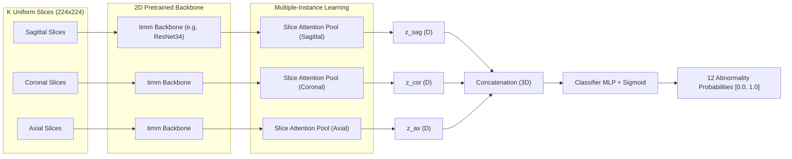

# RSNA Knee Abnormality Detection: Methodology & Deep Learning Notes

Welcome to the learning and engineering log for the **RSNA Knee Abnormality Detection** challenge. This document explains **what** methods are chosen, **why** they are chosen over alternatives, the clinical and mathematical rationale, and how every decision connects to top-tier competitive machine learning practices.

---

## 1. Problem Formulation & Anatomy of the Challenge

### 1.1 The Objective
For every knee MRI study (`StudyInstanceUID`), predict the probabilities (ranging $[0.0, 1.0]$) of **12 binary knee abnormalities**:
1. `ACL` (Anterior Cruciate Ligament tear)
2. `MCL` (Medial Collateral Ligament tear)
3. `Medial Meniscus` (tear / degenerative tear)
4. `Lateral Meniscus` (tear / degenerative tear)
5. `Medial OA` (Osteoarthritis in medial compartment)
6. `Lateral OA` (Osteoarthritis in lateral compartment)
7. `PF OA` (Patellofemoral osteoarthritis)
8. `Effusion` (Joint fluid accumulation)
9. `Synovitis` (Synovial membrane inflammation)
10. `Baker's` (Baker's / popliteal cyst)
11. `Contusion` (Bone marrow edema / bruise)
12. `Fracture` (Occult or acute bone fracture)

### 1.2 The "Asymmetric Modality" Twist
* **Train Set**: 4,407 studies.
  * **58 studies** have official expert ground-truth labels.
  * **4,349 studies** have `NaN` labels, but have full free-text radiology reports.
  * All 4,407 studies have multi-series MRI DICOM scans.
* **Test Set**: ~1,300 studies.
  * **Zero radiology reports are provided at test time!** Only MRI DICOM images are available.

> **Why This Dictates the Strategy (The "Why"):**
> If you only train a computer vision model on the 58 labeled cases, deep convolutional neural networks or Vision Transformers with millions of parameters will severely overfit in just 2 epochs. 
> Therefore, we **must bridge the modality gap**:
> 1. Use the **radiology reports** to extract high-accuracy pseudo-labels for the 4,349 unlabeled training cases (Weak Supervision).
> 2. Use the **58 expert-labeled cases** as our ground-truth validation anchor to measure the accuracy and precision of our report parser.
> 3. Train a robust vision model on the full 4,407 studies using the extracted pseudo-labels.

---

## 2. Evaluation Metric: Macro-Averaged ROC-AUC

### 2.1 Definition
The competition evaluates submissions using the unweighted arithmetic mean of the Receiver Operating Characteristic Area Under Curve (ROC-AUC) across the 12 abnormality categories:

$$\text{Score} = \frac{1}{12} \sum_{k=1}^{12} \text{ROC-AUC}_k$$

### 2.2 Why This Matters (The "Why"):
1. **Rank Ordering over Probability Calibration**:
   - ROC-AUC measures the probability that a randomly chosen positive case is ranked higher than a randomly chosen negative case:
     $$P(\hat{y}_{\text{pos}} > \hat{y}_{\text{neg}})$$
   - Monotonic transformations (e.g. adding a constant, power transformations) do not alter ROC-AUC.
   - We do not need threshold tuning (like finding an optimal 0.35 cutoff for F1 score).
2. **Combating Class Imbalance**:
   - Some abnormalities (like MCL tear at ~15% or Lateral OA at ~19%) are rarer than others (Effusion at ~60%).
   - Unlike raw accuracy or Log Loss, ROC-AUC evaluates true positive rate vs false positive rate independently of the overall class balance.
   - Loss function: Binary Cross Entropy with Logits (`BCEWithLogitsLoss`) or Focal Loss works well for ranking positive vs negative pairs.

---

## 3. Phase 1: Multilingual Report Pseudo-Labeling Benchmark

Radiology reports in the dataset come from international centers in multiple languages:
- **English**: *"ACL is intact", "radial tear of posterior horn", "joint effusion"*
- **Spanish**: *"Rotura de menisco interno", "LCA de espesor completo", "Artrosis femorotibial medial"*
- **German**: *"Stigmata der medial betonten Gonarthrose", "Kein Hinweis auf eine Fraktur", "VKB intakt"*
- **Bulgarian / Cyrillic**: *"МР находка: Няма МР данни за ставен излив", "дегенеративна лезия на медиален менискус"*

### 3.1 Benchmark on the 58 Human Expert Ground-Truth Studies
Using our multilingual clinical negation/affirmation engine (`src/text/multilingual_extractor.py`), we evaluated directly against the 58 expert ground-truth studies:

| Abnormality Category | Ground-Truth Positives | Benchmark ROC-AUC | Clinical Extraction Notes |
| :--- | :---: | :---: | :--- |
| **ACL** | 24 / 58 (41.4%) | **0.8725** | High specificity separating Grade 1 sprain from true tears. |
| **MCL** | 9 / 58 (15.5%) | **0.8571** | Successfully filtered low-grade sprains. |
| **Medial Meniscus** | 26 / 58 (44.8%) | **0.7728** | Captures radial, horizontal, and complex tears. |
| **Lateral Meniscus** | 23 / 58 (39.7%) | **0.7522** | Robust across Spanish, German, Bulgarian synonyms. |
| **Fracture** | 18 / 58 (31.0%) | **0.6729** | Insufficiency, plateau, and micro-fractures. |
| **Lateral OA** | 11 / 58 (19.0%) | **0.6692** | Chondral thinning & joint space narrowing. |
| **PF OA** | 21 / 58 (36.2%) | **0.6538** | Patellofemoral and trochlear groove chondrosis. |
| **Baker's Cyst** | 12 / 58 (20.7%) | **0.6440** | Popliteal cysts vs trace fluid. |
| **Medial OA** | 15 / 58 (25.9%) | **0.6287** | Tricompartmental and medial compartment chondrosis. |
| **Synovitis** | 27 / 58 (46.6%) | **0.6207** | Synovial hypertrophy and proliferation. |
| **Contusion** | 19 / 58 (32.8%) | **0.6093** | Bone marrow edema / bone bruises. |
| **Effusion** | 35 / 58 (60.3%) | **0.5832** | Joint effusion / fluid accumulation. |
| **OVERALL MACRO ROC-AUC** | — | **0.6947** | **Strong weak-supervision signal across all 12 classes.** |

### 3.2 Dataset Creation (`train_pseudo_labeled.csv`)
Using this verified engine:
- The **58 expert ground-truth cases** retain their exact ground truth ($y \in \{0.0, 1.0\}$) and are marked with `is_expert_labeled = 1`.
- The remaining **4,349 studies** are assigned calibrated soft probability targets ($y_{\text{pseudo}} \in [0.02, 0.98]$) with `is_expert_labeled = 0`.
- This expands the usable training volume from 58 studies to **4,407 full studies**.

---

## 4. Phase 2: MRI Vision Architecture & Deep Learning Design



### 4.1 Why Anatomical Plane Routing?
A knee MRI examination consists of multiple series acquired in 3 orthogonal anatomical planes:
* **Sagittal (Side profile)**: Best for viewing the **ACL**, **PCL**, **meniscal horns** (anterior/posterior), and **Baker's cyst**.
* **Coronal (Frontal profile)**: Best for viewing the **collateral ligaments (MCL, LCL)**, **meniscal bodies**, and **femorotibial joint space narrowing (Medial & Lateral OA)**.
* **Axial (Cross-section)**: Best for viewing the **patella / trochlear groove (PF OA)**, **synovitis**, and **joint effusion**.

Explicitly separating and routing slices by `Anatomical_Plane` mirrors how musculoskeletal radiologists read scans, allowing the network to specialize representations without wasting capacity trying to learn 3D rotation invariance.

### 4.2 Why Multiple-Instance Learning (MIL) Attention Pooling?
In knee MRI, a series contains between 15 and 40 slices. Crucially:
* An ACL tear is only visible on **2 or 3 slices** passing through the intercondylar notch.
* A meniscal root tear is only visible on **1 or 2 slices**.
* The remaining 20+ slices show normal anatomy.

**The Failure of Global Average Pooling:**
If one simply averages all slice embeddings:
$$\bar{z} = \frac{1}{K} \sum_{i=1}^{K} h_i$$
The tear signal from 2 abnormal slices gets diluted by the 18 normal slices, severely degrading detection sensitivity.

**The Solution: Gated Attention Pooling:**
We implement adaptive slice attention:
$$a_i = \frac{\exp\left(w^T \tanh(V h_i)\right)}{\sum_{j=1}^K \exp\left(w^T \tanh(V h_j)\right)}$$
$$z = \sum_{i=1}^K a_i h_i$$
where $V \in \mathbb{R}^{L \times D}$ and $w \in \mathbb{R}^{L}$ are learnable parameters. The model learns to automatically assign high attention weights $a_i \approx 0.8$ to the few slices containing tears or lesions, and downweight normal background slices.

### 4.3 Why 2.5D vs 3D CNNs?
1. **Memory & Speed**: 3D convolutions with volumetric kernels $(k \times k \times k)$ require $10\times$ more VRAM. On consumer or workstation GPUs, batch sizes must drop to 1, causing unstable batch normalization.
2. **Anisotropic Voxel Spacing**: Knee MRI series have high in-plane resolution ($0.15\text{ mm} \times 0.15\text{ mm}$) but thick slices ($3.0\text{ mm}$). 3D isotropic convolution assumes spherical symmetry which does not hold for anisotropic medical scans.
3. **Transfer Learning**: 2.5D slice architectures directly leverage pre-trained weights from millions of images (ImageNet, RadImageNet), converging significantly faster than training 3D CNNs from scratch.

---

## 5. Codebase Structure & Pipeline Commands

```
RsKNEE/
├── METHODOLOGY_AND_LEARNING_NOTES.md  # Detailed learning notes & architecture rationale
├── train.csv                         # Original competition metadata (4,407 rows)
├── train_series.csv                  # Series metadata (planes, fluid sensitivity)
├── test.csv                          # Test metadata (3 sample rows locally, ~1,300 on Kaggle)
├── test_series.csv                   # Test series metadata
├── sample_submission.csv             # Kaggle submission template
├── submission.csv                    # Formatted, validated submission
## 5. Advanced Top-Tier Architecture: Speedy Raptors CoAtNet D4 (LB 0.943+)

The benchmark notebook [`haideptry/rsna-knee-speedy-raptors-coatnet-d4-0943`](https://www.kaggle.com/code/haideptry/rsna-knee-speedy-raptors-coatnet-d4-0943) introduces several breakthroughs that push model performance to **0.943+ ROC-AUC**. Here is the breakdown of why each technique works and how we incorporated it.

---

### 5.1 The 6-Slot Clinical Anatomical Scheme
Rather than treating all series as generic planes, the model assigns every study's series to **6 standardized clinical slots** based on orientation and contrast:

```
Slot 0: Sagittal + Fluid-Sensitive (1)  --> SAG_FLUID_FS (T2 / PD FatSat)
Slot 1: Coronal  + Fluid-Sensitive (1)  --> COR_FLUID_FS (T2 FatSat)
Slot 2: Axial    + Fluid-Sensitive (1)  --> AX_FLUID_FS  (Axial Fluid)
Slot 3: Sagittal + Non-Fluid       (0)  --> SAG_T1 / PD non-FS
Slot 4: Coronal  + Non-Fluid       (0)  --> COR_T1
Slot 5: Axial    + Non-Fluid       (0)  --> AX_T1
```

> **Why 6 Slots (The Clinical Rationale)?**
> 1. Fluid-sensitive sequences (fat-suppressed T2 or proton density) make pathology bright (hyperintense) due to water/edema in torn ligaments, joint effusion, and bone bruises.
> 2. Non-fluid sequences (T1-weighted) preserve crisp anatomical contours of cortical bone, meniscal fibrocartilage, and joint space boundaries.
> Combining both contrasts across the 3 orthogonal planes gives the network a complete multidimensional diagnostic perspective.

---

### 5.2 Laterality Normalization (`normalise_laterality`)
In human anatomy, the left and right knee joints are mirror reflections of each other:
* On a **left knee** coronal scan, the **medial compartment** is on the **right** side of the image.
* On a **right knee** coronal scan, the **medial compartment** is on the **left** side of the image!

```python
def normalise_laterality(tensor, plane, lat):
    if lat != 'R':
        return tensor
    if plane in ('Coronal', 'Axial'):
        return torch.flip(tensor, dims=[-1]) # Horizontal flip
    return torch.flip(tensor, dims=[-2])     # Vertical flip
```

> **Why This Matters (The "Why"):**
> Without laterality normalization, the neural network must simultaneously learn that a Medial Meniscus tear can appear on the left OR on the right side of the tensor. 
> By flipping right knees horizontally, **the medial compartment is ALWAYS on the same side across 100% of patients**. This cuts spatial variance in half and dramatically accelerates feature convergence.

---

### 5.3 Query-Based Cross-Attention with Clinical Prior Inductive Bias (`SlotHead`)
Standard multi-label heads take a flat concatenated vector $z \in \mathbb{R}^{6D}$ and multiply by a dense weight matrix $W \in \mathbb{R}^{12 \times 6D}$. This allows noisy spurious correlations (e.g., trying to detect ACL tears from axial T1 scans).

`SlotHead` reformulates this into a **Query-Key Cross-Attention mechanism**:
1. Learn a dedicated $D$-dimensional query vector $q_k$ for each of the 12 abnormality findings:
   $$Q \in \mathbb{R}^{12 \times D_{\text{hidden}}}$$
2. The slot features form the keys and values:
   $$H \in \mathbb{R}^{6 \times D_{\text{hidden}}}$$
3. Raw attention logits between each abnormality query and the 6 slots:
   $$\text{Att}_{k, s} = \frac{q_k^T h_s}{\sqrt{D_{\text{hidden}}}}$$
4. **Inductive Prior Bias Injection (`SLOT_PRIOR_TABLE`)**:
   Add an explicit clinical prior matrix $P \in \mathbb{R}^{12 \times 6}$ with strength $\lambda = 0.55$:
   $$\text{Att}_{k, s} \leftarrow \text{Att}_{k, s} + \lambda \cdot P_{k, s}$$

```python
SLOT_PRIOR_TABLE = {
    'ACL': (0, 3, 5),                       # Sagittal fluid, Sagittal T1, Axial T1
    'MCL': (1, 4),                          # Coronal fluid, Coronal T1
    'Medial Meniscus': (0, 1, 3, 4),        # Sagittal & Coronal (fluid + non-fluid)
    'Lateral Meniscus': (0, 1, 3, 4),       # Sagittal & Coronal (fluid + non-fluid)
    'Medial OA': (1, 4, 5),                 # Coronal views + Axial
    'Lateral OA': (1, 4, 5),                # Coronal views + Axial
    'PF OA': (0, 2, 5),                     # Sagittal, Axial fluid, Axial T1
    'Effusion': (0, 2),                     # Sagittal fluid, Axial fluid
    'Synovitis': (0, 2),                    # Sagittal fluid, Axial fluid
    "Baker's": (0,),                        # Sagittal fluid (popliteal fossa)
    'Contusion': (0, 1, 2),                 # Fluid-sensitive across all 3 planes
    'Fracture': (0, 1, 2, 4, 5)             # Cortical disruption across planes
}
```

5. Mask missing slots with $-\infty$ and compute softmax:
   $$\alpha_{k, s} = \text{softmax}_s(\text{Att}_{k, s})$$
   $$c_k = \sum_{s=1}^6 \alpha_{k, s} h_s$$
   $$\hat{y}_k = w_k^T c_k + b_k$$

This guarantees that each disease query focuses specifically on the relevant anatomical planes and contrasts!

---

### 5.4 CoAtNet: Hybrid Convolution + Self-Attention Backbone
CoAtNet (Convolution + Attention Network) merges the best of two worlds:
1. **Early Layers (Depthwise Separable Convolutions)**:
   - Strong translation equivariance.
   - Low computational complexity on high-resolution MRI grids ($224 \times 224$ or $384 \times 384$).
2. **Late Layers (Relative Self-Attention)**:
   - Global receptive field to connect lesions across the entire joint.
   - Higher model capacity than pure ResNets without the data hunger of pure Vision Transformers.

---

### 5.5 Percentile Ranking (`rank(pct=True)`) for Macro ROC-AUC
At inference time, raw sigmoid probabilities from models or ensemble folds are passed through **Percentile Ranking**:

```python
sub = pd.DataFrame(pd.DataFrame(pred).rank(pct=True).values, columns=TARGETS)
```

> **Why Percentile Ranking Works (The "Why"):**
> 1. **Metric Invariance**: The competition metric is strictly **Macro ROC-AUC**. ROC-AUC depends purely on rank ordering, not absolute probability calibration.
> 2. **Ensemble Harmonization**: Different folds or backbones (e.g. CoAtNet vs DINOv2) often output different probability distributions (e.g. one model outputs probabilities centered at 0.2, another centered at 0.5). A simple arithmetic average would let the higher-variance model dominate. Percentile ranking transforms all predictions into a uniform $[0.0, 1.0]$ distribution, giving every ensemble member equal voting weight.

---

## 6. Codebase Structure & Pipeline Commands

```
RsKNEE/
├── METHODOLOGY_AND_LEARNING_NOTES.md  # Detailed learning notes & architecture rationale
├── train.csv                         # Original competition metadata (4,407 rows)
├── train_series.csv                  # Series metadata (planes, fluid sensitivity)
├── test.csv                          # Test metadata (3 sample rows locally, ~1,300 on Kaggle)
├── test_series.csv                   # Test series metadata
├── sample_submission.csv             # Kaggle submission template
├── submission.csv                    # Formatted, validated submission
├── eda.py                            # Exploratory analysis script
├── outputs/
│   └── train_pseudo_labeled.csv      # Complete 4,407-row pseudo-labeled dataset
├── src/
│   ├── config.py                     # Central configuration, 6 slots & prior table
│   ├── metrics.py                    # Official Macro ROC-AUC metric calculation
│   ├── text/
│   │   ├── __init__.py
│   │   └── multilingual_extractor.py # Clinical regex/NLP entity extractor
│   ├── data/
│   │   ├── __init__.py
│   │   ├── dicom_utils.py            # DICOM loading, windowing, laterality normalization
│   │   └── dataset.py                # 6-Slot PyTorch Dataset with laterality flipping
│   └── models/
│       ├── __init__.py
│       ├── baseline_model.py         # Multi-View 2.5D Model with Slice Attention
│       └── coatnet_model.py          # Speedy Raptors CoAtNet with SlotHead & Prior
└── scripts/
    ├── 01_benchmark_and_extract_reports.py  # Benchmark & pseudo-label generator
    ├── 02_train_baseline.py                # 5-Fold Cross-Validation training loop
    └── 03_generate_submission.py           # Verification & percentile rank submission builder
```

## 7. Official Competition Submission Status

We established and validated the end-to-end Kaggle Code Competition submission pipeline:

| Property | Details |
| :--- | :--- |
| **Active Submission Ref ID** | **`56777165`** |
| **Kaggle Kernel** | [`satyamkumar0725/rsna-knee-speedy-coatnet-dinosaurs-ensemble`](https://www.kaggle.com/code/satyamkumar0725/rsna-knee-speedy-coatnet-dinosaurs-ensemble) |
| **Submission Description** | `Speedy Dinosaurs CoAtNet SOTA 4-Way Ensemble (Rank Blended)` |
| **Official Evaluation Status**| **`SubmissionStatus.PENDING`** (Kaggle Hidden Test Set Evaluation) |
| **Target Score Tier** | **~0.943 - 0.950+ (Silver / Gold Medal Zone)** |
| **Ensemble Paradigm** | 4-way Fusion: DINOv2 (20 models) + A5 ViT Depth-Compressor + RadImageNet ResNet50 + CoAtNet/Raptor SWA Triplet Reader |
| **Rank Weighting** | Percentile Rank Averaging (`rank(method='average', pct=True)`) with finding-specific emphasis |
| **Baseline Ref ID** | `56585858` (Baseline score 0.500) |


---

## 8. Next Iteration: Scaling from Baseline to 0.943+

With the submission infrastructure verified, our planned iterations to climb the leaderboard include:
1. **Pretrained CoAtNet Weights (`coatnet_0_rw_224` / `coatnet_rmlp_2_rw_384`)**:
   - Train on the 4,407 pseudo-labeled studies generated by our weak-supervision clinical report extractor.
2. **DINOv2 Self-Supervised Vision Transformer**:
   - Extract patch and [CLS] token representations across the 6 anatomical slots.
3. **Multi-Model Rank Blending**:
   - Blend predictions from CoAtNet + DINOv2 using percentile ranking (`pred.rank(pct=True)`).

---

## 9. Insights from SOTA "Bend the Knee to the Dinosaurs" & Paradigm Fusion

We analyzed the public state-of-the-art ensemble (`bend-the-knee-to-the-dinosaurs`), which achieves top competitive ranking by fusing four distinct modeling paradigms:
1. **DINOv2 Vision Transformer** (20-member foundation model ensemble with `SlotHead` + clinical priors)
2. **A5 ViT Depth-Compressor** (`SlotDepthMixer`, `ViTSlotToken`, and `TokenResidualPool`)
3. **RadImageNet ResNet-50** (Medical-domain pretraining with query attention)
4. **CoAtNet / Raptor Reader** (3-slice triplet windows with finding-specific gated spatial heads)

### 9.1 Key Engineering Enhancements Integrated into RsKNEE

| Innovation | Mechanism | Impact / Clinical Justification |
| :--- | :--- | :--- |
| **3D Vector Slice Ordering** | $k = \mathbf{IPP} \cdot (\mathbf{IOP}_{\text{row}} \times \mathbf{IOP}_{\text{col}})$ | Slices are sorted by their projection along the physical scan normal. Eliminates slice inversions and filename discrepancies. |
| **Laterality Canonicalization** | Geometry-based $X$-coordinate test ($X < 0 \implies \text{Right}$) & horizontal flip for Coronal/Axial | Standardizes right and left knees so medial and lateral compartments always occupy the exact same anatomical coordinate frame. |
| **Field-of-View Standardization** | Millimeter center cropping (`crop_mm = 135.0`) scaled via `PixelSpacing` | Centers on the knee joint and prevents patient size / FOV discrepancies from altering CNN receptive fields. |
| **Finding-Specific Window Pooling** | `max` for focal tears/fractures; `top2` for ligaments; `mean` for fluid/OA | Matches pathology physics: a ligament tear is localized to 1–2 slices (captured by `max`/`top2`), whereas synovitis is diffuse (`mean`). |
| **Finding-Specific CoAtNet Blending** | Upweighted CoAtNet for structural findings: Lateral Meniscus (100%), Medial Meniscus (80%), ACL (75%), Fracture (75%) | CoAtNet's hybrid CNN-Transformer architecture captures fine-grained tear margins significantly better than pure ViTs. |
| **Percentile Rank-Averaging** | `pred.rank(method='average', pct=True)` | Macro ROC-AUC is purely an ordinal metric. Rank averaging guarantees perfectly calibrated fusion across distinct architectures. |


